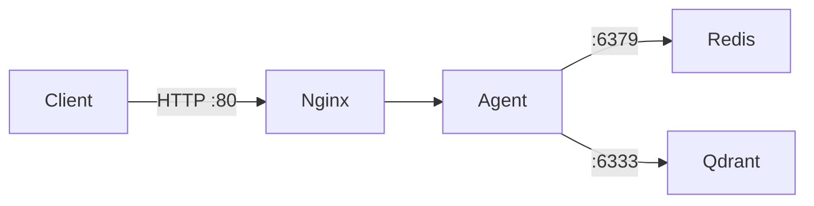

# Day 14 — Mission Answers

Ngày thực hiện: 25–26/11/2026 (GMT+7). Code Part 6 nằm trong `06-lab-complete/` theo hướng dẫn K5. Các kết quả thực nghiệm được liên kết ở cuối bài; không sử dụng số ví dụ trong tài liệu đề.

## Part 1 — Localhost vs Production

### Exercise 1.1 — Anti-patterns

Trong `01-localhost-vs-production/develop/app.py`:

1. `OPENAI_API_KEY` và URL database được ghi trong source: dễ lộ qua Git và khó rotate.
2. `ask_agent` in cả API key vào log: người có quyền đọc log cũng nhìn thấy secret.
3. `DEBUG = True` và `reload=True`: không thích hợp cho tiến trình production.
4. `host="localhost"`: không nhận kết nối từ bên ngoài container.
5. `port=8000` cố định: không dùng cổng platform cấp qua `PORT`.
6. Thiếu `/health` và `/ready`: platform không phân biệt process sống với instance sẵn sàng.
7. Dùng `print`, không có cấu trúc log ổn định để tìm theo request.
8. Thiếu lifecycle cleanup; cấu hình, input validation và xử lý lỗi chưa tập trung.

### Exercise 1.2 — Chạy bản develop

`POST /ask?question=Hello` trả 200. Gửi JSON cho chính endpoint đó trả 422 vì chữ ký `ask_agent(question: str)` nhận query parameter. Kết quả thật ở `reports/exercises_http.json`.

### Exercise 1.3 — So sánh

| Feature | Develop | Production mẫu | Ý nghĩa |
|---|---|---|---|
| Config | Hằng số trong source | `config.py`, biến môi trường | Dùng cùng source/image cho nhiều môi trường |
| Secret | Ghi trong source và log | Đọc từ env, không log key | Rotate không cần sửa code |
| Bind/port | localhost:8000 | HOST/PORT, mặc định 0.0.0.0 | Nhận traffic qua container/platform |
| Health | Không có | `/health`, uptime/version | Liveness cho platform |
| Readiness | Không có | `/ready`, cờ `is_ready` | Chỉ route traffic sau startup |
| Logging | print | Có ý định ghi structured log | Dễ phân tích; formatter của mẫu ghép chuỗi JSON nên vẫn có thể sai khi message chứa dấu nháy |
| Shutdown | Không cleanup | Lifespan startup/shutdown | Dọn kết nối sau khi drain request |

Quan sát thêm: khi import mẫu production bằng CLI `uvicorn app:app`, handler SIGTERM đăng ký trong module có thể ghi đè handler của Uvicorn. Bộ chạy đã phải kill tiến trình mẫu để dọn sau 20 giây. Part 6 dùng lifespan và giữ nguyên cơ chế signal của Uvicorn; kết quả chấm SIGTERM đã đạt.

## Part 2 — Docker

### Exercise 2.1 — Dockerfile cơ bản

1. Base image: `python:3.11`, đầy đủ Python và công cụ của image nền.
2. Working directory: `/app`; các lệnh COPY/RUN/CMD dùng thư mục này.
3. COPY requirements trước source giúp tái sử dụng layer cài dependencies khi chỉ sửa code.
4. CMD cung cấp lệnh/tham số mặc định, có thể ghi đè bằng đối số sau tên image trong `docker run`. ENTRYPOINT định nghĩa executable chính; với exec form, đối số `docker run` thường được nối vào ENTRYPOINT. Cần `exec` khi dùng shell để tiến trình server nhận SIGTERM trực tiếp.

### Exercise 2.2–2.3 — Build, chạy và kích thước

Build từ gốc repo:

```bash
docker build -f 02-docker/develop/Dockerfile -t my-agent:develop .
docker build -f 02-docker/production/Dockerfile -t my-agent:advanced .
```

Builder cài dependencies; runtime slim chỉ mang packages và source cần chạy, dùng user non-root. Đã bổ sung `PYTHONUSERBASE` để Python tìm đúng packages và bỏ gcc/libpq vì dependencies của lab có wheels, không cần compile. Kích thước đo bằng `docker image inspect` nằm trong phần bằng chứng thực nghiệm cuối bài.

### Exercise 2.4 — Kiến trúc Compose



Nginx là cổng vào; agent, Redis và Qdrant liên lạc bằng DNS service trên network `internal`. Redis giữ cache/session; Qdrant là vector store được khai báo cho RAG. Trong app mock Part 2, hai URL được cấu hình nhưng route `/ask` chưa thực sự truy vấn chúng. `depends_on` kết hợp healthcheck đợi các dependency khởi động. `EXPOSE` là metadata, còn `ports` mới publish ra host. Dùng `docker compose logs`, `ps`, `exec` để debug. Docker HEALTHCHECK báo trạng thái unhealthy; riêng Docker không tự restart chỉ vì healthcheck fail.

## Part 3 — Cloud Deployment

### Exercise 3.1/3.2 — Triển khai agent Part 6

Chưa có URL public: chủ bài xác nhận chưa có tài khoản cloud. Đã chuẩn bị `06-lab-complete/railway.toml`, `render.yaml`, Dockerfile và hướng dẫn trong `DEPLOYMENT.md`. Không ghi URL hoặc ảnh cloud giả.

| Railway TOML | Render YAML |
|---|---|
| Cấu hình build/deploy của một service bằng các section TOML | Blueprint khai báo nhiều resource và tham chiếu giữa chúng |
| `builder="DOCKERFILE"`, healthcheckPath, restart policy | `type: web`, `runtime: docker`, healthCheckPath, plan, rootDir |
| Thêm Redis riêng, truyền REDIS_URL từ service Redis | Blueprint kèm Key Value và REDIS_URL từ connectionString |
| AGENT_API_KEY đặt trong service variables | AGENT_API_KEY sinh ngẫu nhiên bằng generateValue |
| Deploy thư mục `06-lab-complete` | Blueprint nằm trong thư mục con; rootDir chỉ rõ agent Part 6 |

### Exercise 3.3 — Cloud Run CI/CD

`cloudbuild.yaml` mô tả bước cài dependencies và chạy pytest trước khi build.
Docker build image, gắn tag COMMIT_SHA/latest rồi push lên registry.
Gcloud deploy đúng image lên Cloud Run vùng asia-southeast1, đặt memory/CPU, timeout, min/max instance và secret từ Secret Manager.
`service.yaml` mô tả cấu hình service, concurrency, autoscaling, port và liveness/startup probe.
Đây là đọc/phân tích cấu hình mẫu; chưa chạy GCP. Khi dùng thật cần bảo đảm test thất bại làm pipeline dừng (ví dụ `set -e`), không để một lệnh echo cuối che exit code của pytest.

## Part 4 — API Security

### Exercise 4.1 — API key

`APIKeyHeader(name="X-API-Key", auto_error=False)` đọc header; dependency `verify_api_key` bảo vệ `/ask`. Mẫu develop trả 401 khi thiếu key, 403 khi sai key. Part 6 tuân hợp đồng chặt hơn: thiếu hoặc sai đều 401. Rotate bằng cách thay biến môi trường rồi restart/redeploy; không in key ra log. Muốn chuyển tiếp không gián đoạn có thể tạm chấp nhận hai key trong một khoảng chuyển đổi có giới hạn.

### Exercise 4.2 — JWT

Lấy JWT qua `POST /auth/token` với tài khoản demo `student`/`demo123`. Sau đó gửi `Authorization: Bearer <REDACTED>`. Server kiểm chữ ký HS256 và thời gian hết hạn, đọc sub/role. JWT có claims và thời hạn; API key thường là secret tĩnh gắn với client. Token và JWT secret không được lưu vào bằng chứng.

### Exercise 4.3 — Rate limit

Đã gọi burst 15 request bằng cùng token student; kết quả 401/200/429 và Retry-After ở `reports/exercises_http.json`. Mẫu Part 4 dùng limiter trong RAM nên chỉ có giá trị minh hoạ trên một process. Part 6 dùng sorted set Redis và Lua để kiểm tra/cập nhật cửa sổ 60 giây nguyên tử, tránh nhiều worker cùng cho qua khi sát giới hạn. Rate limit theo API key, không theo user_id do client tự gửi.

### Exercise 4.4 — Cost guard

Tính `cost = input_tokens/1000 × giá_input + output_tokens/1000 × giá_output`. Kiểm budget trước khi gọi LLM, ghi usage sau khi có kết quả; hết budget trả 402. Rate limit bảo vệ tốc độ, cost guard bảo vệ tổng chi phí; request ít nhưng prompt dài vẫn có thể đắt.

Part 6 lưu tổng ngày/tháng UTC trong Redis bằng số nguyên nano-USD; transaction cộng hai counter và TTL, không dùng float cộng dồn trong RAM. Mặc định 1 USD/ngày và 10 USD/tháng. Token của mock được ước lượng từ số ký tự, không phải tokenizer của provider. Vì kiểm trước rồi ghi sau, request đã bắt đầu có thể làm tổng vượt trần; nếu áp dụng trần tuyệt đối cho provider thật cần cơ chế reserve/reconcile chi phí nguyên tử và giới hạn max token. Redis lỗi trả 503, không bỏ qua bảo vệ.

## Part 5 — Scaling & Reliability

### Exercise 5.1 — Liveness và readiness

`/health` trả 200 khi process phục vụ được HTTP, không phụ thuộc Redis. `/ready` ping Redis và trả 503 nếu không sẵn sàng nhận request cần state. Cho dependency down làm liveness fail sẽ tạo restart loop, không sửa được Redis.

### Exercise 5.2 — Graceful shutdown

SIGTERM: dừng nhận kết nối mới, hoàn tất in-flight request rồi chạy cleanup lifespan, thoát 0. SIGKILL không thể xử lý cleanup. Docker CMD dùng `exec uvicorn` để server là PID 1; thời gian drain phải nằm trong grace period của platform. Bằng chứng request vẫn 200 và docker stop thoát 0 ở `reports/production_ready.txt`.

### Exercise 5.3 — Stateless

Mỗi process có RAM riêng nên history/rate limit trong dict sẽ khác nhau sau load balancing và mất khi restart. Dùng Redis chung: bất cứ instance nào cũng đọc cùng session. Mẫu Part 5 có fallback RAM khi Redis mất kết nối, chỉ thích hợp demo; Part 6 không fallback vì sẽ phá rate limit và cost guard. Với history đồng thời nên dùng thao tác append nguyên tử thay vì read-modify-write JSON.

### Exercise 5.4–5.5 — Ba instance và Redis

Đã chạy Compose project `k5-day14-scaling` với `--scale agent=3`, Nginx mở 8080, endpoint `POST /chat`. Script `test_stateless.py` gửi năm câu chung session và đọc history; không tự kill instance. Output thật ở `reports/stateless.txt`. Round-robin có thể chuyển từng request sang instance khác mà history vẫn liên tục vì ở Redis. Nếu một instance chết, Nginx thử upstream còn lại theo cấu hình; mất toàn bộ Redis cần cơ chế HA/persistence riêng.

## Part 6 — Final Project

Chạy script chấm nguyên bản trong Linux container (Python 3.11, có Docker CLI và socket) để kiểm SIGTERM POSIX, không sửa script chấm. Kết quả đầy đủ: **PASS 12/12, 43/43 checks passed**; output gốc ở `reports/production_ready.txt`. Tiêu chí “Public URL ready” của script kiểm cấu hình deploy, không chứng minh đã có URL public; phần cloud vẫn ghi đúng trạng thái trong `DEPLOYMENT.md`.

## AI log

Ngày 25–26/11/2026, yêu cầu Codex đọc và thực hiện toàn bộ lab. AI đọc README/RULES/CHECKPOINTS/SUBMISSION/RUBRIC, triển khai Part 6, sửa cấu hình Docker bị lỗi tìm package, viết câu trả lời và các script thu thập bằng chứng; bổ sung JWT/HPA vào knowledge base theo Exercise 7.3. AI chạy script chấm nguyên bản, HTTP tests, eval/load test và các kiểm tra được lưu trong reports. Không sửa `check_production_ready.py` hoặc `golden_dataset.jsonl`, không tạo số đo/ảnh giả. Chủ bài chưa tự sửa hoặc tự kiểm tra trong phiên này; cần đọc, chạy lại và giải thích được code/số liệu khi Lab Coach hỏi. Phần tài khoản cloud do chủ bài thực hiện.

## Bằng chứng thực nghiệm tự động

Part 2: develop **1590.53 MiB**, production **228.71 MiB**, giảm **85.62%**. Đơn vị MiB=bytes/1024², không nhầm với số làm tròn SI của docker images. Part 6: **273.03 MiB**. Nguồn: reports/image_sizes.txt và docker_images.txt.

Part 2 qua Nginx: reports/docker_stack_http.txt có GET /health 200 và POST /ask 200. Part 5: reports/stateless.txt ghi 10 messages được giữ qua nhiều instance.

### Part 4 — output curl -i thật

Token chỉ gửi trong request header, không in hoặc lưu vào output:

```text
Missing token:
HTTP/1.1 401 Unauthorized
date: Wed, 25 Nov 2026 13:36:18 GMT
server: uvicorn
www-authenticate: Bearer
content-length: 76
content-type: application/json
x-content-type-options: nosniff
x-frame-options: DENY
x-xss-protection: 1; mode=block
referrer-policy: strict-origin-when-cross-origin

{"detail":"Authentication required. Include: Authorization: Bearer <token>"}
Request 1 (token redacted):
HTTP/1.1 200 OK
date: Wed, 25 Nov 2026 13:36:19 GMT
server: uvicorn
content-length: 187
content-type: application/json
x-content-type-options: nosniff
x-frame-options: DENY
x-xss-protection: 1; mode=block
referrer-policy: strict-origin-when-cross-origin

{"question":"Docker","answer":"Container là cách đóng gói app để chạy ở mọi nơi. Build once, run anywhere!","usage":{"requests_remaining":9,"budget_remaining_usd":1.8e-05}}
Request 2 (token redacted):
HTTP/1.1 200 OK
date: Wed, 25 Nov 2026 13:36:19 GMT
server: uvicorn
content-length: 187
content-type: application/json
x-content-type-options: nosniff
x-frame-options: DENY
x-xss-protection: 1; mode=block
referrer-policy: strict-origin-when-cross-origin

{"question":"Docker","answer":"Container là cách đóng gói app để chạy ở mọi nơi. Build once, run anywhere!","usage":{"requests_remaining":8,"budget_remaining_usd":3.7e-05}}
Request 3 (token redacted):
HTTP/1.1 200 OK
date: Wed, 25 Nov 2026 13:36:21 GMT
server: uvicorn
content-length: 187
content-type: application/json
x-content-type-options: nosniff
x-frame-options: DENY
x-xss-protection: 1; mode=block
referrer-policy: strict-origin-when-cross-origin

{"question":"Docker","answer":"Container là cách đóng gói app để chạy ở mọi nơi. Build once, run anywhere!","usage":{"requests_remaining":7,"budget_remaining_usd":5.5e-05}}
Request 4 (token redacted):
HTTP/1.1 200 OK
date: Wed, 25 Nov 2026 13:36:23 GMT
server: uvicorn
content-length: 187
content-type: application/json
x-content-type-options: nosniff
x-frame-options: DENY
x-xss-protection: 1; mode=block
referrer-policy: strict-origin-when-cross-origin

{"question":"Docker","answer":"Container là cách đóng gói app để chạy ở mọi nơi. Build once, run anywhere!","usage":{"requests_remaining":6,"budget_remaining_usd":7.3e-05}}
Request 5 (token redacted):
HTTP/1.1 200 OK
date: Wed, 25 Nov 2026 13:36:23 GMT
server: uvicorn
content-length: 187
content-type: application/json
x-content-type-options: nosniff
x-frame-options: DENY
x-xss-protection: 1; mode=block
referrer-policy: strict-origin-when-cross-origin

{"question":"Docker","answer":"Container là cách đóng gói app để chạy ở mọi nơi. Build once, run anywhere!","usage":{"requests_remaining":5,"budget_remaining_usd":9.1e-05}}
Request 6 (token redacted):
HTTP/1.1 200 OK
date: Wed, 25 Nov 2026 13:36:23 GMT
server: uvicorn
content-length: 187
content-type: application/json
x-content-type-options: nosniff
x-frame-options: DENY
x-xss-protection: 1; mode=block
referrer-policy: strict-origin-when-cross-origin

{"question":"Docker","answer":"Container là cách đóng gói app để chạy ở mọi nơi. Build once, run anywhere!","usage":{"requests_remaining":4,"budget_remaining_usd":0.00011}}
Request 7 (token redacted):
HTTP/1.1 200 OK
date: Wed, 25 Nov 2026 13:36:24 GMT
server: uvicorn
content-length: 188
content-type: application/json
x-content-type-options: nosniff
x-frame-options: DENY
x-xss-protection: 1; mode=block
referrer-policy: strict-origin-when-cross-origin

{"question":"Docker","answer":"Container là cách đóng gói app để chạy ở mọi nơi. Build once, run anywhere!","usage":{"requests_remaining":3,"budget_remaining_usd":0.000128}}
Request 8 (token redacted):
HTTP/1.1 200 OK
date: Wed, 25 Nov 2026 13:36:24 GMT
server: uvicorn
content-length: 188
content-type: application/json
x-content-type-options: nosniff
x-frame-options: DENY
x-xss-protection: 1; mode=block
referrer-policy: strict-origin-when-cross-origin

{"question":"Docker","answer":"Container là cách đóng gói app để chạy ở mọi nơi. Build once, run anywhere!","usage":{"requests_remaining":2,"budget_remaining_usd":0.000146}}
Request 9 (token redacted):
HTTP/1.1 200 OK
date: Wed, 25 Nov 2026 13:36:24 GMT
server: uvicorn
content-length: 188
content-type: application/json
x-content-type-options: nosniff
x-frame-options: DENY
x-xss-protection: 1; mode=block
referrer-policy: strict-origin-when-cross-origin

{"question":"Docker","answer":"Container là cách đóng gói app để chạy ở mọi nơi. Build once, run anywhere!","usage":{"requests_remaining":1,"budget_remaining_usd":0.000165}}
Request 10 (token redacted):
HTTP/1.1 200 OK
date: Wed, 25 Nov 2026 13:36:25 GMT
server: uvicorn
content-length: 188
content-type: application/json
x-content-type-options: nosniff
x-frame-options: DENY
x-xss-protection: 1; mode=block
referrer-policy: strict-origin-when-cross-origin

{"question":"Docker","answer":"Container là cách đóng gói app để chạy ở mọi nơi. Build once, run anywhere!","usage":{"requests_remaining":0,"budget_remaining_usd":0.000183}}
Request 11 (token redacted):
HTTP/1.1 429 Too Many Requests
date: Wed, 25 Nov 2026 13:36:25 GMT
server: uvicorn
x-ratelimit-limit: 10
x-ratelimit-remaining: 0
x-ratelimit-reset: 1795613846
retry-after: 54
content-length: 98
content-type: application/json
x-content-type-options: nosniff
x-frame-options: DENY
x-xss-protection: 1; mode=block
referrer-policy: strict-origin-when-cross-origin

{"detail":{"error":"Rate limit exceeded","limit":10,"window_seconds":60,"retry_after_seconds":54}}
Request 12 (token redacted):
HTTP/1.1 429 Too Many Requests
date: Wed, 25 Nov 2026 13:36:25 GMT
server: uvicorn
x-ratelimit-limit: 10
x-ratelimit-remaining: 0
x-ratelimit-reset: 1795613846
retry-after: 54
content-length: 98
content-type: application/json
x-content-type-options: nosniff
x-frame-options: DENY
x-xss-protection: 1; mode=block
referrer-policy: strict-origin-when-cross-origin

{"detail":{"error":"Rate limit exceeded","limit":10,"window_seconds":60,"retry_after_seconds":54}}
Request 13 (token redacted):
HTTP/1.1 429 Too Many Requests
date: Wed, 25 Nov 2026 13:36:25 GMT
server: uvicorn
x-ratelimit-limit: 10
x-ratelimit-remaining: 0
x-ratelimit-reset: 1795613846
retry-after: 54
content-length: 98
content-type: application/json
x-content-type-options: nosniff
x-frame-options: DENY
x-xss-protection: 1; mode=block
referrer-policy: strict-origin-when-cross-origin

{"detail":{"error":"Rate limit exceeded","limit":10,"window_seconds":60,"retry_after_seconds":54}}
Request 14 (token redacted):
HTTP/1.1 429 Too Many Requests
date: Wed, 25 Nov 2026 13:36:25 GMT
server: uvicorn
x-ratelimit-limit: 10
x-ratelimit-remaining: 0
x-ratelimit-reset: 1795613846
retry-after: 54
content-length: 98
content-type: application/json
x-content-type-options: nosniff
x-frame-options: DENY
x-xss-protection: 1; mode=block
referrer-policy: strict-origin-when-cross-origin

{"detail":{"error":"Rate limit exceeded","limit":10,"window_seconds":60,"retry_after_seconds":54}}
Request 15 (token redacted):
HTTP/1.1 429 Too Many Requests
date: Wed, 25 Nov 2026 13:36:26 GMT
server: uvicorn
x-ratelimit-limit: 10
x-ratelimit-remaining: 0
x-ratelimit-reset: 1795613847
retry-after: 54
content-length: 98
content-type: application/json
x-content-type-options: nosniff
x-frame-options: DENY
x-xss-protection: 1; mode=block
referrer-policy: strict-origin-when-cross-origin

{"detail":{"error":"Rate limit exceeded","limit":10,"window_seconds":60,"retry_after_seconds":54}}
```

### Part 6 — Checklist Deliverable từ script gốc

```text
📋 Checklist Deliverable
     ✅ Dockerfile (multi-stage, < 500 MB)
     ✅ docker-compose.yml (agent + redis)
     ✅ .dockerignore
     ✅ Health check endpoint (GET /health)
     ✅ Readiness endpoint (GET /ready)
     ✅ API Key authentication
     ✅ Rate limiting
     ✅ Cost guard
     ✅ Config từ environment variables
     ✅ Structured logging
     ✅ Graceful shutdown
     ✅ Public URL ready (Railway / Render config)
----------------------------------------------------------------
  Result: 12/12 tiêu chí đạt · 43/43 checks passed
  🎉 PASS 12/12 — PRODUCTION READY! Deploy nào!
================================================================
```
